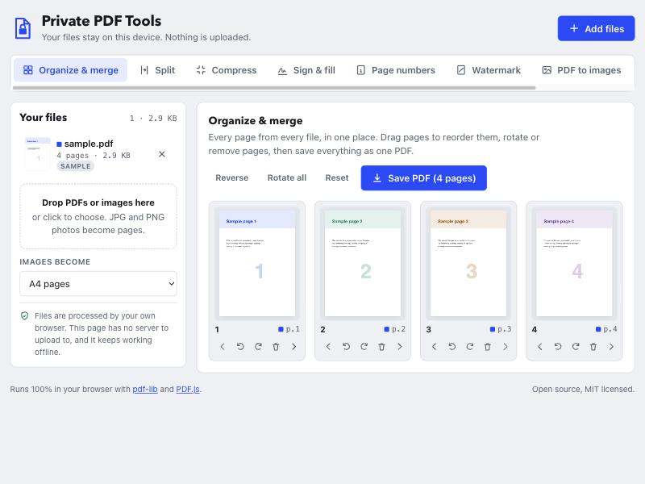

# Private PDF Tools: free offline PDF editor in your browser

**Merge, split, compress, sign, rotate, reorder, watermark and number PDF pages, entirely on your own device.** No uploads, no sign-up, no server. It's a free, open-source, privacy-first alternative to online PDF sites like iLovePDF, Smallpdf and Adobe Acrobat online.



## Why

Most "free online PDF tools" upload your contracts, bank statements, IDs and invoices to someone else's server. This one doesn't. Every operation runs in JavaScript inside your browser tab, so your files never leave your computer or phone. After the first visit it also works **offline**, and you can install it as an app (PWA).

## Features

| Tool | What it does |
| --- | --- |
| **Organize & merge** | Combine several PDFs into one. Drag and drop to reorder pages, rotate pages, delete pages. |
| **Split** | Split a PDF by page ranges (`1-3, 5, 8-10`) or every N pages. Extract pages to a new PDF. |
| **Compress** | Reduce PDF file size for email and upload limits: a lossless mode plus three image-quality levels. |
| **Sign & fill** | Draw, type or upload a signature, then add text and dates. Fill and e-sign PDF forms. |
| **Page numbers** | Add page numbers (`Page 1 of 10`) in any corner, with a custom start number. |
| **Watermark** | Stamp text such as CONFIDENTIAL or DRAFT diagonally across every page. |
| **PDF to images** | Convert PDF pages to PNG or JPG images, downloaded as a ZIP file. |
| **Images to PDF** | Drop JPG, PNG, WebP or screenshots to convert them into a PDF (A4, Letter or original size). |
| **Remove metadata** | View and strip author, creator app, dates and XMP metadata before sharing a PDF. |

You can also paste a PDF or screenshot with <kbd>Ctrl</kbd>/<kbd>Cmd</kbd>+<kbd>V</kbd>.

## Use it

- **Online:** <https://shafaaijaz-glitch.github.io/private-pdf-tools/>
- **Locally:** it's a static site with no build step and no dependencies to install.

```bash
git clone https://github.com/shafaaijaz-glitch/private-pdf-tools.git
cd private-pdf-tools
python3 -m http.server 8000
```

Then open <http://localhost:8000>. Any static file server works (`npx serve`, nginx, Apache…). Opening `index.html` straight from disk won't work, because browsers block ES modules on `file://`.

## Host your own copy

Fork the repo, then go to **Settings → Pages → Source: GitHub Actions**. The included workflow (`.github/workflows/pages.yml`) publishes the site on every push to `main`. It also works on Netlify, Vercel, Cloudflare Pages or any web server: just upload the folder.

## How it works

- [pdf-lib](https://pdf-lib.js.org) edits PDFs: merging, splitting, rotating, stamping, metadata.
- [PDF.js](https://mozilla.github.io/pdf.js/) by Mozilla renders page previews and rasterises pages.
- [JSZip](https://stuk.github.io/jszip/) bundles multiple outputs into one `.zip` download.
- A service worker (`sw.js`) caches the app for offline use.

All libraries are vendored in `vendor/`, so the page makes **no requests to CDNs, analytics or font hosts**. It's plain HTML, CSS and vanilla JavaScript (ES modules), with no framework and no build tools.

```
index.html          app shell
css/styles.css      styles (light and dark mode)
js/app.js           file library, import, downloads, tool switching
js/ops.js           all PDF operations (pure functions on bytes)
js/render.js        PDF.js page rendering
js/tools/*.js       one file per tool
vendor/             pdf-lib, PDF.js, JSZip
```

## Limitations

- Password-protected (encrypted) PDFs must be unlocked in a PDF reader first.
- Strong compression turns pages into images, so text can no longer be selected on those pages.
- Very large files (hundreds of MB) are limited by your device's memory.

## Contributing

Issues and pull requests are welcome. If you find a PDF that doesn't open or process correctly, please open an issue (but don't attach anything private).

## License

[MIT](LICENSE). Bundled third-party libraries keep their own licenses; see [vendor/LICENSES.md](vendor/LICENSES.md).

---

**Keywords:** PDF tools, PDF editor, merge PDF, combine PDF, split PDF, compress PDF, reduce PDF size, sign PDF, e-signature, fill PDF form, rotate PDF, reorder PDF pages, delete PDF pages, extract PDF pages, PDF to JPG, PDF to PNG, JPG to PDF, image to PDF, watermark PDF, add page numbers to PDF, remove PDF metadata, offline PDF editor, private PDF tool, client-side PDF, browser-based PDF, no upload PDF, free PDF tool, open-source PDF, PWA, pdf-lib, PDF.js, iLovePDF alternative, Smallpdf alternative, Adobe Acrobat alternative.
